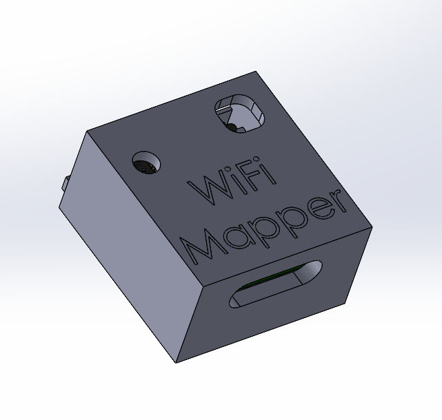
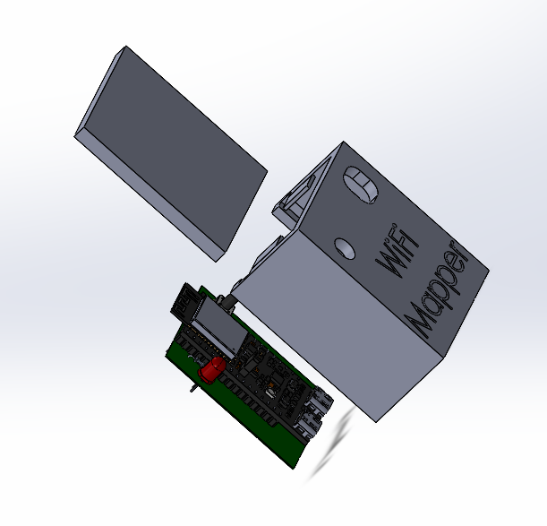
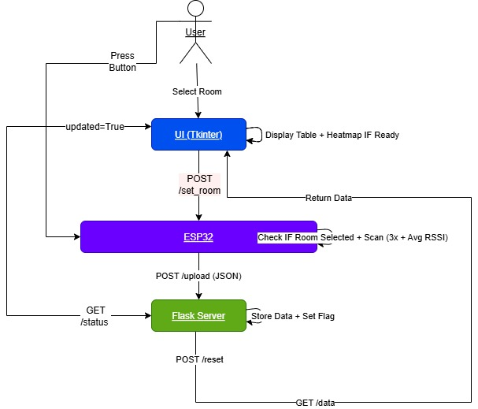

# 📶 Wi-Fi Signal Mapper

A low-cost, portable device that **measures indoor Wi-Fi signal strength room by room and turns it into a heatmap**, so you can find weak spots and dead zones.

It combines a **custom ESP32 PCB** (designed in Altium), a **Flask server** and a **Tkinter desktop app**. Junior engineering project (ISS396) at MedTech – South Mediterranean University, built by a team of 5.

<p>
  
  
</p>

## How it works

1. Load a floor-plan **layout file** in the desktop app (`layouts/rooms.txt`: one room per line as `name,x,y,width,height`).
2. Select a room in the app; it is sent to the ESP32.
3. Press the **push button** on the device. The ESP32 runs several Wi-Fi scans, **averages the RSSI** of each network and keeps the strongest ones. The LED shows progress.
4. The results are sent to the **Flask server**, and the app picks them up automatically.
5. Once every room is scanned, pick a network and generate a **colour heatmap** of its signal across the floor plan.



## Repository structure

```
firmware/wifi_scanner/   ESP32 firmware (Arduino): scanning, RSSI averaging, HTTP upload, button + LED
server/                  Flask server that stores scan results (/upload, /data, /status, /reset, /clear)
ui/                      Tkinter desktop app: room selection, results table, heatmap
layouts/                 Example floor-plan layout files
hardware/altium/         Altium project: schematic, PCB layout, Gerber manufacturing files
hardware/3d/             3D-printable enclosure (STL)
docs/                    Final report, presentation, diagrams and photos
```

## Run it

1. **Firmware:** open `firmware/wifi_scanner/wifi_scanner.ino` in the Arduino IDE (ESP32 board package and ArduinoJson installed), set `ssid`, `password` and `serverUrl`, then flash it.
2. **Server:**
   ```bash
   pip install flask
   python server/server.py
   ```
3. **Desktop app:** set `ESP_URL` and `SERVER_URL` at the top of `ui/ui.py`, then:
   ```bash
   pip install requests
   python ui/ui.py
   ```

## Tech stack

ESP32 · Arduino (C++) · Python · Flask · Tkinter · Altium Designer · 3D printing

## Team

Amine Ben Nasrallah · Adem Arroum · Asser Hermassi · Mehdi Kassab · Houssem Rafraf. Supervised by Dr. Nourhene Akrouti.

📄 [Final report](docs/final-report.pdf) · 📊 [Presentation](docs/presentation.pdf) · 🔌 [Schematic](hardware/altium/main_schematic.pdf)
